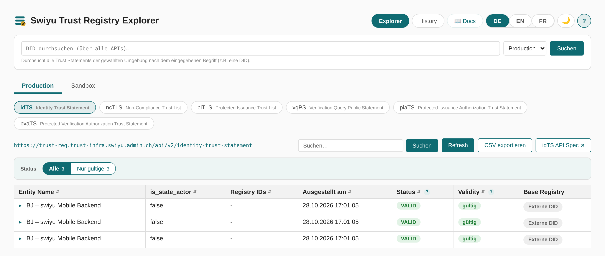

# Trust Registry Explorer

A lightweight PHP tool for browsing and searching the [swiyu](https://www.eid.admin.ch/) Trust Registry APIs across multiple environments — decodes the returned JWTs and displays their contents in readable, searchable tables.

> This project is fully developed and maintained with [Claude](https://claude.com) (Anthropic).

## Features

- **Multiple environments** — PROD and INT-PROD out of the box; further environments are added per installation via an untracked local config file (see *Local configuration*)
- **Six supported APIs** — `ncTLS`, `piTLS`, `vqPS`, `piaTS`, `pvaTS`, `idTS`
- **JWT decoding** (header + payload, no signature verification) with human-readable timestamps
- **Pagination and full-text search** — search automatically loads and searches across *all* pages of an API, not just the currently displayed one. Multiple terms are combined with AND (`urn:vct:ch.admin.astra.vz.mdl AND did:tdw:…`, the word `AND` is optional); `OR` matches either, `"exact phrase"` searches a phrase and `-term` excludes entries containing it
- **Expandable row details** — click any row to see every field present in that entry's JWT; empty fields are explicitly marked as such, missing fields simply don't appear (so you can see at a glance which translations/attributes exist for a given entry)
- **Raw data view** — every expanded row (and the list panel of `ncTLS`/`piTLS`) has a switch "Parsed | Raw data" (same as for the Base Registry): the raw view shows the JWT header and payload as unmodified, formatted JSON plus the original compact JWT (incl. signature), each with a copy button — e.g. to paste it into a decoder of your choice. Nothing is sent to third parties
- **Global DID search** — search a single DID across all six APIs at once and see every place it appears, with the entity name (from idTS) shown up front if available
- **Base Registry integration** — for every idTS entry the DID is looked up in the environment's Base Registry (`<base_registry_url>/api/v1/did/<UUID>/did.jsonl`, UUID = last segment of the DID). The idTS table has a "Base Registry" column showing the number of DID log versions (loaded lazily via AJAX for the visible rows only); the expanded row has a "Base Registry" tab with version history, keys and the raw log. The global DID search shows Trust Registry and Base Registry side by side, with a "View DID log" dialog (parsed / raw). Supports `did:tdw` 0.3 and `did:webvh` 1.0. Signatures / hash chain are *not* verified. DIDs hosted on another registry are shown as "External DID"
- **Valid-only status filter** — for APIs with a status list per entry (`row_status`: idTS, piaTS, pvaTS) a toggle "All | Valid only" above the table hides everything whose status-list value is not `valid` (revoked, suspended and unknown). Only the status list counts, not the time-based validity. Entries whose status cannot be determined count as not valid, with a warning. The filter is a URL parameter (`&status=valid`) and survives search, sorting, paging and page size
- **CSV export** — the "Export CSV" button in the toolbar downloads the table exactly as shown: all pages, with the current search, status filter and sorting applied, same columns as the table, statuses as plain text (no coloured pills). UTF-8 with BOM and `;` as separator so Excel opens it directly; the lazily loaded "Base Registry" column and the expanded row content are not included. Cell values starting with `=`, `+`, `@` or `-` are prefixed with an apostrophe to prevent formula injection
- **Guided tour** — a short tour (environments, the APIs and what each is for, expanding entries, searching and filtering, Explorer vs. History, the search across all APIs) starts automatically on a visitor's very first visit to the Explorer and never again by itself, not even after an update. It can be restarted any time with the round **?** button in the header (both pages), with a link ending in `?tour=1`, or from the bar shown at the end of the tour. If no API is selected when the tour reaches the table steps, it loads `idTS` first. Available in DE/EN/FR; keyboard (arrow keys, Esc), screen-reader and reduced-motion friendly; bottom sheet on phones. The "seen" flag lives only in the visitor's browser (`localStorage` key `tre.tour.seen`, with a cookie as fallback if `localStorage` is blocked) — there is no account or server-side state
- **Responsive UI** — full table on desktop, stacked card view on mobile, same underlying data and markup
- **Config-driven** — add a new environment or API by editing `config.php`, no other code changes needed
- **History tracking** — a nightly cron job records the total number of trust statements per environment/API into a local SQLite database; a chart view (`history.php`) lets you pick a time range and any combination of environment/API curves to compare, with a logarithmic/linear scale toggle. Chart.js is vendored locally (`assets/chart.umd.min.js`) — no CDN dependency, works on hosts without outbound access to third-party script CDNs
- **Dark mode** — follows the OS/browser color scheme by default; a toggle (🌙/☀️, top right on both pages) lets you override it, remembered across visits. Covers the Explorer, the History page, and the History chart's colors (axes, grid, curves)
- **Logo & favicon** — a two-color "registry stack" mark (Petrol `#0F6B72` & Gold `#D9A62B`) in the browser tab and next to the title on both pages; the same two colors drive `--accent`/`--accent-2` everywhere else in the UI (active tab, links, buttons, the first two chart curves), so the brand is consistent top to bottom
- **Preview marker** — an optional `storage/.preview` file switches a deployment into "preview look" (badge, greyed-out favicon and header logo, `[Preview]` tab title, `noindex`); see *Marking a preview instance*. The logo/title in the header is a link back to the home page
- **Loading spinner** — the logo doubles as a subtle animated indicator (bars pulse, seal pops) shown over the table/chart while a page reload is in flight, e.g. switching to an API with 1'500+ entries (vqPS)

## Screenshot



## Requirements

- PHP 8.1 or newer
- PHP extensions: `curl`, `session`, `pdo_sqlite` (only needed for the History feature)
- Outbound HTTPS access to the relevant `*.trust-infra.swiyu.admin.ch` (or `*.swiyu-int.admin.ch`) hosts
- For the History feature: the ability to schedule a cron job, and a writable `storage/` directory

## Setup

1. Copy `config.php`, `functions.php`, `index.php`, `history.php`, `collect.php`, the `assets/` folder, and the `storage/` folder (with its `.gitkeep` and `.htaccess`) into the same directory on your web server (or run locally, see below).
2. Point your web server's document root at that directory, or run it locally for a quick test:

   ```bash
   php -S localhost:8000
   ```

3. Open the page in a browser, pick an environment tab, then an API — that's it, no build step or dependencies to install.

### Protecting `storage/`

`storage/` holds runtime data (the History SQLite database, the collector log, the preview marker) that must not be downloadable. The bundled `storage/.htaccess` denies all web access to the folder on Apache (2.4 and 2.2); PHP still reads and writes it via the file system. Make sure the `.htaccess` file is deployed too (it is a dotfile and easy to miss when copying) and that `AllowOverride` permits it. On **nginx**, `.htaccess` has no effect; add this to the server block instead:

```nginx
location /storage/ { deny all; }
```

Check after deployment that `https://your-host/path/storage/history.sqlite` returns 403 (or 404). Alternatively, point `history.db_path` in `config.php` to a directory outside the web root.

### Marking a preview instance

To make a staging/preview deployment visually distinguishable from production, create an empty marker file on that server only:

```bash
touch storage/.preview
```

While the file exists, the app shows a gold "PREVIEW" badge next to the title, uses a greyed-out favicon and Apple touch icon, prefixes the browser tab title with `[Preview]`, and sends `noindex, nofollow`. Remove the file (or never create it) and the app looks like production. The marker lives in `storage/`, which is untouched by code deployments, and is listed in `.gitignore`, so the code is identical on the `preview` and `main` branches and no host names end up in the repository.

### Enabling History tracking

The History view (`history.php`) reads from a local SQLite database that a
separate collector script fills. This is opt-in — the Explorer itself works
without it — but to see any data in the History chart:

1. Make sure `storage/` (see `history.db_path` in `config.php`) is writable
   by whichever user runs the cron job (and readable by the web server user
   for `history.php`).
2. Schedule `collect.php` to run once a night, e.g. via crontab:

   ```
   0 23 * * * php /path/to/project/collect.php
   ```

   `collect.php` is CLI-only (it refuses to run through the web server). It
   queries every configured environment × API combination for its current
   total entry count — always counting **all** statements, active and
   inactive, regardless of any filter — and stores one row per combination
   per run in `storage/history.sqlite`. A failed query is stored as an
   explicit error row (not a zero), so a bad night shows up as a gap in the
   chart rather than a misleading drop.

   The script writes its own log to `storage/collect.log` (resolved via
   `__DIR__`, not via shell redirection), so it works reliably even on
   hosting panels/schedulers whose working directory isn't the project
   folder. A `>> .../collect.log 2>&1` redirect on the cron line is
   harmless but no longer necessary.
3. After a couple of nightly runs, open `history.php`, pick a time range and
   the environment/API curves you want to compare.

## Versioning & releases

The app follows [Semantic Versioning](https://semver.org/). The current version is `'version'` at the top of `config.php`; it is shown in the footer of both pages (with a link to the matching GitHub release, plus a link to the repository). On a preview instance the footer adds "· preview".

Assets (`assets/*.css`, `*.js`, favicons) are referenced with a content hash (`assetUrl()` in `functions.php`, e.g. `theme.css?v=1a2b3c4d`), so browsers fetch a changed file immediately after a deployment without clearing the cache.

- **Minor** (`1.x.0`): new features. **Patch** (`1.0.x`): bug fixes. **Major** (`x.0.0`): breaking changes, e.g. a changed `config.php` structure or a manual update step.
- Releases are created automatically: when a change to `config.php` reaches `main` and `'version'` has no matching tag yet, the workflow `.github/workflows/release.yml` creates the tag `vX.Y.Z`, a GitHub release with generated notes, and attaches `trust-registry-explorer-vX.Y.Z.zip` (built with `git archive`; see `.gitattributes` for excluded files). If the tag already exists, nothing happens. The release notes are built by `.github/scripts/release_notes.py` from the PRs merged into `main` since the previous release (PR title plus description, without the test plan). A manual run of the workflow ("Run workflow", optionally with a tag) regenerates the notes of an existing release.
- Release flow: feature PRs go to `preview` as usual; a small PR to `preview` bumps `'version'` (so the preview already shows the upcoming version); then the `preview` → `main` PR is merged and the release appears on its own. Only that release PR should change `'version'`.

## Configuration

Everything that can change — environments, APIs, their columns, and a few global settings — lives in `config.php`. No other file needs to be touched to extend the tool.

### Adding a new environment

Environments that may be public live in `config.php`:

```php
'environments' => [
    'PROD' => ['label' => 'PROD', 'base_url' => 'https://trust-reg.trust-infra.swiyu.admin.ch', 'base_registry_url' => 'https://identifier-reg.trust-infra.swiyu.admin.ch'],
    // add a new one the same way:
    'NEW-ENV' => ['label' => 'NEW-ENV', 'base_url' => 'https://your-new-host.example.ch'],
],
```

Environments that must **not** be in the repository (e.g. internal pre-production systems) go into the local config file described next.

### Local configuration (per installation)

One repository can be deployed to several systems that show different environments. Anything installation-specific lives in the optional, untracked file `storage/config.local.php`. It returns an array in the same structure as `config.php`, which is laid over the base config:

```php
<?php
return [
    'environments' => [
        'MY-ENV' => ['label' => 'MY-ENV', 'base_url' => 'https://trust-reg.example.internal', 'base_registry_url' => 'https://identifier-reg.example.internal'],
    ],
    // optional: tab order; the first entry is the default environment
    'environment_order' => ['MY-ENV', 'PROD', 'INT-PROD'],
];
```

- Nested keys such as `environments` or `history` are merged entry by entry; lists and plain values are replaced. Without `environment_order`, added environments appear after the ones from `config.php`.
- The file is listed in `.gitignore` and is not touched when you pull or deploy new code, so the repository itself knows nothing about the extra environments. `storage/` is protected from web access (see *Protecting `storage/`*); keep it that way for this file, too.
- A syntax or runtime error in the file does not take the app down: it is logged (`error_log`) and the base config stays active.
- `collect.php` and the History view use the merged config, so each installation records exactly the environments it shows. History databases are per installation.

### Adding a new API

```php
'apis' => [
    'myAPI' => [
        'label'       => 'myAPI',
        'description' => 'What this API represents',
        'path'        => '/api/v2/my-endpoint',
        // 'single_jwt_list': the endpoint returns ONE JWT whose payload contains a list field
        // 'paginated_jwt':   the endpoint returns {"content": [JWT, ...], "page": {...}} and supports ?page=&size=
        'mode'        => 'paginated_jwt',
        'expandable'  => true, // allow clicking a row to see the full decoded entry
        'columns'     => [
            ['key' => 'sub', 'label' => 'Subject (DID)', 'type' => 'text'],
            ['key' => 'iat', 'label' => 'Issued at',     'type' => 'unix'],
            // 'text' | 'unix' | 'iso' | 'list' | 'raw_bool' | 'multilang' | 'registry_ids'
        ],
    ],
],
```

Other settings in `config.php`:

- `page_size` — how many rows are shown per page after filtering/searching
- `cache_ttl` — how long fetched data is kept in the PHP session before a new "Query" click forces a refresh

## Architecture

Three files, each with a single responsibility:

| File | Responsibility |
|---|---|
| `config.php` | Environments, APIs, paths, column definitions, cache settings, History settings — the only file most extensions require |
| `functions.php` | JWT decoding, HTTP fetching (incl. following pagination), full-text search, per-entry detail rendering, cross-API DID search, History helpers (counting, SQLite access, time-range resolution) |
| `index.php` | The UI: environment tabs, API selector, DID search bar, table/card rendering, pagination |
| `.github/workflows/release.yml`, `.github/scripts/release_notes.py`, `.gitattributes` | Release automation (tag, GitHub release, ZIP on a version change in `config.php`) and the list of files kept out of the ZIP |
| `collect.php` | CLI-only nightly collector for the History feature — counts all trust statements per environment/API and stores a snapshot in SQLite |
| `history.php` | The History UI: time range picker, environment/API curve selection matrix, Chart.js line chart |
| `base_registry.php` | JSON endpoint used by the browser to load the Base Registry chip/detail for one DID (host from `config.php`, only the UUID is taken from the DID) |
| `assets/base-registry.css`, `assets/base-registry.js` | Styling and front-end logic (lazy chip loading, tabs, DID log dialog) for the Base Registry views |
| `assets/chart.umd.min.js` | Chart.js, vendored locally so `history.php` has no external CDN dependency |
| `assets/theme.css` | Light/dark color tokens (CSS custom properties), shared by `index.php` and `history.php` — the only place to adjust a color. Also defines the `.tre-logo`/`.tre-spinner` icon styling and the `.tre-loading-overlay` component |
| `assets/theme.js` | Dark-mode logic: follows the OS setting by default, the toggle button overrides it and remembers the choice (`localStorage`), fires a `trustexplorer:themechange` event other scripts (the History chart) can react to. Also exposes `TrustExplorer.attachLoadingOverlay()`, which wires the loading spinner to a page's links/forms |
| `assets/tour.css`, `assets/tour.js` | The guided tour (dependency-free). Steps are plain configuration at the top of `tour.js` (target element via `data-tour="…"`, text key); all texts live in `lang.php` under `tour.*`; colors come from `theme.css` |
| `assets/favicon-preview.svg`, `favicon-preview.ico`, `apple-touch-icon-preview.png` | Greyed-out variants of the logo (contrast ≥ 4.5:1 against white and against dark `#202124` tab backgrounds; the SVG switches via `prefers-color-scheme`), used instead of the regular icons while `storage/.preview` exists |
| `assets/favicon.svg`, `favicon.ico`, `favicon-*.png`, `apple-touch-icon.png` | The logo mark, rendered to the sizes browsers/OSes expect for a tab icon / bookmark / home-screen icon. Regenerate from `assets/favicon.svg` if the mark ever changes |

### Brand colors

Petrol (`#0F6B72` light / `#4FB8AE` dark) and Gold (`#D9A62B` light / `#E8B93E` dark) are the product's two colors — used in the logo, the favicon, and reused throughout the UI via `--accent`/`--accent-2` (and their `-fill`/`-soft` variants) in `assets/theme.css`. To restyle the brand, change the values there; nothing elsewhere hardcodes a color.

The registry pages through its list by offset and the order of entries with identical `iat`/`nbf`/`exp` is not stable between requests (and there is no unique sort field), so a single run over all pages shows some statements twice and misses others. Paginated APIs are therefore loaded in up to 6 passes with alternating sort direction and page size (50, 47, 43, …), merged and de-duplicated by `jti`, until `page.totalElements` is reached (usually after 2 passes). If an API rejects the `sort` parameter, it is loaded unsorted.

Fetched and decoded entries are cached per environment+API in the PHP session for `cache_ttl` seconds, so paging and searching don't repeatedly hit the upstream API. The "Query" button forces an immediate refresh.

## Limitations

- **Base Registry logs are parsed, not verified.** The parser follows the did:tdw 0.3 / did:webvh 1.0 formats; `patch` log lines (tdw) are not applied (keys are shown from the last full document with a note).
- **JWT signatures are not verified.** This is a display/inspection tool, not a trust or integrity check — don't rely on it to validate authenticity.
- **Session-based cache**, not shared between users — each visitor triggers their own fetches.
- **No authentication.** Anyone with access to the deployed page can see everything it can reach; deploy accordingly (e.g. behind your own access control if needed).
- **History data is only as good as the cron job.** If `collect.php` isn't scheduled (or fails silently at the infrastructure level, e.g. PHP not found), no snapshots are recorded and the chart stays empty — check `storage/collect.log` if you configured logging as shown above.

## Feature requests & issues

Found a bug or have an idea for a new feature (e.g. another API, another column)? Please [open an issue](https://github.com/laudatioUno/trust-registry-explorer/issues) on GitHub.

## License

MIT — see [LICENSE](LICENSE).
